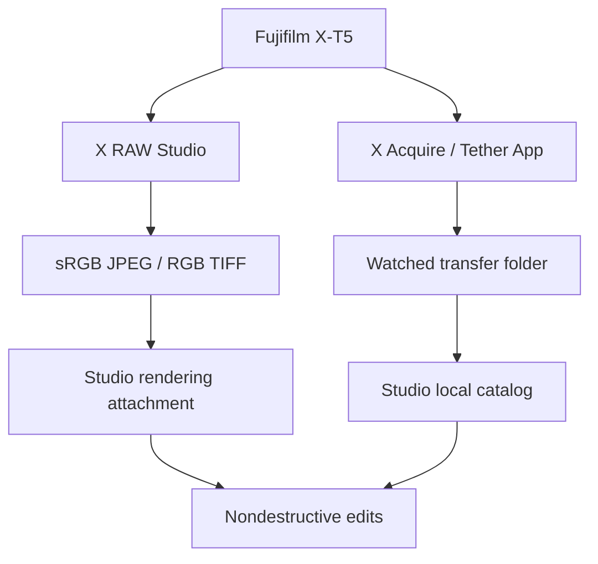

# Camera integration boundary

The working integration is a **file-based round-trip**. No private Fujifilm USB
protocol, reverse-engineered camera writes, Adobe binary, or SDK binding is
included. The UI reports direct camera control as unavailable.

## Implemented

- `integration.py`: detect/launch the installed X RAW Studio application using
  argument arrays and no shell. macOS `.app` and Windows `.exe` paths; explicit
  `--x-raw-studio` path for nonstandard installations.
- `FolderWatcher`: persistent folder configuration, stable-file import,
  size/mtime-based change detection, duplicate content detection, retry of partial
  writes, and catalog-folder rejection.
- Explicit rendering attachment: the user chooses the correspondence between
  original RAF and a rendered JPEG/TIFF/PNG. Original and render are kept separate.
- The local image pipeline can then operate on the attached camera rendering or
  independently develop the RAF with LibRaw. These modes are visibly distinct.

## Direct integration work still needed

1. Decide whether SDK transfer / shutter / basic controls add enough value over
   Fujifilm's supported transfer apps; review current license and warranty terms.
2. Obtain the SDK through Fujifilm's official download route. Verify redistribution
   rights before shipping anything. Keep licensed SDK binaries outside this repo.
3. Implement an opt-in native adapter with explicit device enumeration,
   connection/disconnection, capability queries, timeouts, exclusive camera access,
   capture, and file transfer. Do not infer access from a browser's USB device list.
4. Use the transfer callback to commit completed files atomically to the watched
   folder. Test interrupted cable/power, duplicate names, large RAFs, disk-full,
   cancellation and reconnect. Add a clear camera ownership state.
5. Validate on an actual X-T5 with recorded firmware, OS, SDK and compression modes.
   Never claim RAF conversion from the control SDK; Fujifilm explicitly excludes it.

## Software-only film profiles

There is no included official Fuji RAW film-simulation implementation. A future
camera-matching system needs camera input profiles, a documented color space and
transform order, and original, measured profiles validated against color charts
and camera outputs across lighting conditions. Label independently developed
matches as approximations. Do not extract or redistribute Adobe/Fujifilm profiles
without the necessary rights. `.cube` grading alone does not reproduce the
camera's demosaic, dynamic range, white balance, grain, Color Chrome or clarity.

## Primary references

- [Fujifilm SDK capabilities and terms](https://www.fujifilm-x.com/global/camera-control-sdk/)
- [X-T5 USB RAW processing instructions](https://app.fujifilm-dsc.com/en-int/manual/x-t5/connections/raw/)
- [X-T5 software / transfer support](https://fujifilm-dsc.com/en-int/manual/x-t5/technical_notes/software/)
- [X RAW Studio](https://www.fujifilm-x.com/global/support/download/software/x-raw-studio/)
- [rawpy processing parameters](https://letmaik.github.io/rawpy/api/rawpy.Params.html)
- [Fujifilm metadata tags](https://exiftool.org/TagNames/FujiFilm.html)
